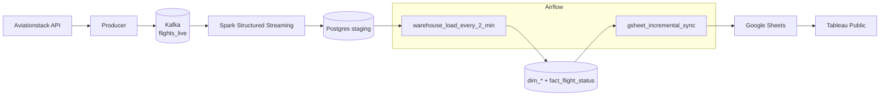

# Flights Data Pipeline with Airflow

> **Status: first iteration.** The maintained, more complete version of this project (Kafka → Spark → Postgres star schema → Airflow → Google Sheets → Tableau, with a test suite) is
> [Real-Time-Flight-Data-Pipeline](https://github.com/dohmandjo/Real-Time-Flight-Data-Pipeline). This repository is kept for history.

Live flight events from the **Aviationstack** API flow through **Kafka** and **Spark Structured Streaming** into a **PostgreSQL** star schema. **Apache Airflow** runs two DAGs on top of it: the warehouse load (every 2 minutes) and an incremental export to **Google Sheets** (every minute), which feeds a Tableau Public dashboard.

[](../../actions/workflows/ci.yml)



## Layout

```text
.
├── docker-compose.yml          # kafka, producer, postgres, spark, airflow (init / webserver / scheduler)
├── .env.example                # copy to .env
├── kafkaproducer/              # API -> Kafka
├── spark_app/                  # Kafka -> Postgres staging
├── postgres/
│   ├── 00_warehouse.sql        # staging, dimensions, fact
│   └── 01_create_airflow_db.sh # separate metadata DB for Airflow
├── airflow/
│   ├── Dockerfile
│   └── dags/
│       ├── _defaults.py            # retry policy shared by all DAGs
│       ├── warehouse_sql.py        # staging -> star-schema statements
│       ├── warehouse_load_dag.py
│       ├── sheets_export.py        # watermark + append logic (no Airflow imports)
│       └── gsheet_sync_dag.py
└── tests/                      # pytest: DAG checks, SQL against real Postgres, Sheets export
```

## Run it

```bash
cp .env.example .env      # fill in the blanks (the file explains how to generate the keys)
docker compose up -d --build
```

Airflow UI: <http://localhost:8080> (user and password from `.env`). The Google service-account key stays **outside** the repository; point `GSA_KEY_PATH` at it and share your sheet with the service account's e-mail.

## Reliability notes

| Where | What |
|---|---|
| Producer | Retries with backoff; Aviationstack's HTTP-200 error bodies (bad key, quota) are treated as failures and logged |
| Airflow | Every task: 3 retries, exponential backoff (30 s → 5 min), 10-minute timeout, `max_active_runs=1`, `catchup=False` |
| Warehouse load | One `REPEATABLE READ` transaction; each upsert first collapses staging to the newest row per key (`DISTINCT ON`), so a flight polled several times per cycle cannot break `ON CONFLICT`; the final `DELETE` removes only rows that were loaded |
| Sheets export | Keyset watermark `(ingest_time, flight_key)` stored as an Airflow Variable and advanced only after a successful append (at-least-once) |

## Tests

```bash
pip install "apache-airflow==2.9.3" -r requirements-dev.txt \
  --constraint https://raw.githubusercontent.com/apache/airflow/constraints-2.9.3/constraints-3.11.txt
# point at a DISPOSABLE Postgres: the schema file DROPs tables
docker run -d --name pgtest -e POSTGRES_PASSWORD=postgres -p 5433:5432 postgres:16
TEST_PG_DSN="host=localhost port=5433 dbname=postgres user=postgres password=postgres" pytest
```

Without `TEST_PG_DSN` the Postgres tests are skipped.

## License

Apache-2.0, see [LICENSE](LICENSE).
